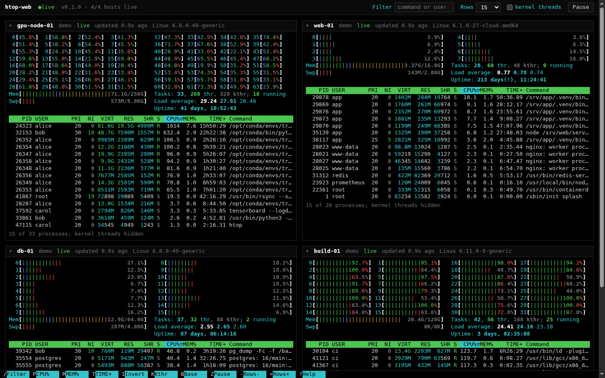

# 📟 htop-web

**A web interface of [htop](https://htop.dev): monitor Linux hosts at a glance.**

Inspired by [gpustat-web](https://github.com/wookayin/gpustat-web): run one command, list your
hosts, and every host's CPU cores, memory, load and busiest processes show up in one live page.
Nothing is installed on the hosts.

<p align="center">
  
</p>


## Installation

```bash
pip install htop-web
```

Python 3.10+ is required on the machine that runs htop-web. The hosts need Linux and `python3`
(3.6 or newer), nothing else.

On Debian and Ubuntu, pip refuses to install into the system Python
(`error: externally-managed-environment`, PEP 668). Use [pipx](https://pipx.pypa.io) there
(`sudo apt install pipx`, then `pipx install htop-web`) or a virtual environment. For the latest
code on GitHub: `pip install git+https://github.com/leekyungmoon/htop-web.git`.


## Usage

```bash
htop-web                              # this machine, no SSH
htop-web gpu01 gpu02 alice@db01:2222  # hosts over SSH; ~/.ssh/config aliases work too
htop-web --demo                       # made-up hosts, to try it out
```

Then open <http://127.0.0.1:48110/>. `python -m htop_web` works the same way.

Each host gets one SSH connection. htop-web sends a small collector script
([`htop_web/collector.py`](https://github.com/leekyungmoon/htop-web/blob/main/htop_web/collector.py),
standard library only) over that connection's
stdin and runs it with `python3 -u -`. The script reads `/proc` and prints one JSON line per
interval; it exits on its own when the connection goes away. When a host fails, its panel says
why (host key not trusted, authentication failed, `python3` not found, timed out, ...) and
htop-web reconnects with backoff.

The page follows htop's default look: per-core CPU bars, the Mem and Swp bars, tasks, load
average, uptime, and the process table (`PID USER PRI NI VIRT RES SHR S CPU% MEM% TIME+ Command`).
The server sorts and filters, and sends each page only the rows it shows.

| Key | Does |
|-----|------|
| `/` | filter by command or user (`Esc` clears it) |
| `P` `M` `T` | sort by CPU%, MEM%, TIME+ (or click a column header) |
| `I` | invert the sort order |
| `K` | show or hide kernel threads |
| `B` | highlight program names |
| `F` | Fit: every host on one screen, no scrolling |
| `C` | number of host columns: auto, 1 to 6 |
| `Z` | pause updates |
| `+` `-` | more or fewer rows |
| `?` | help |

Click a host's title to fold it. Add `?nodes=gpu01,gpu02` to the address to show some hosts only.

For a wall display, open `/?fit=1`: the hosts share one screen without scrolling, each panel
shows as many processes as fit, and the text shrinks when it has to. `&cols=4` puts four hosts
side by side. Fit is meant for big screens; on a phone it may leave room only for the meters.

### Options

```
--port PORT          web server port (default: 48110)
--bind ADDR          address to listen on (default: 127.0.0.1)
--interval SEC       seconds between updates (default: 2)
--procs N            process rows per host; the page can change it (default: 15)
--ssh-port PORT      SSH port for hosts that give none (default: ~/.ssh/config, else 22)
--no-verify-host     skip SSH host key checks (not recommended)
--python PATH        Python interpreter on the hosts (default: python3)
--ssl-certfile FILE  serve HTTPS with this certificate ...
--ssl-keyfile FILE   ... and this key
--demo               show made-up hosts instead
```

### Endpoints

- `/`: the live page, updated over a websocket
- `/htop.json`: the same data as JSON
- `/htop.txt`: plain text
- `/htop.ansi`: text in htop's colors, for a terminal: `curl -s localhost:48110/htop.ansi`

They all take `?nodes=a,b`, `sort` (`cpu`, `mem`, `time`, `pid`, `user`, `res`, ...), `order`
(`asc`/`desc`), `rows`, `filter` and `kthreads=1`. The text ones also take `width`.


## Security

- **It listens on 127.0.0.1 by default.** The page shows every process with its full command
  line, and command lines can hold secrets (tokens or passwords passed as arguments). To see it
  from another machine, prefer an SSH tunnel (`ssh -L 48110:127.0.0.1:48110 workstation`). If you
  use `--bind 0.0.0.0`, also set `HTOP_WEB_AUTH=user:password` in the environment for HTTP Basic
  auth (it is read from the environment so it never shows up in a process list) and serve HTTPS
  with `--ssl-certfile`/`--ssl-keyfile`.
- **It is read-only.** It never kills, renices or changes anything on the hosts.
- **SSH host keys are checked** against `~/.ssh/known_hosts`. Run `ssh HOST` once (or
  `ssh -o StrictHostKeyChecking=accept-new HOST`) to trust a new host. `--no-verify-host` turns
  the check off.
- **Strings from hosts are untrusted.** The page inserts them as text, never as HTML. The text
  endpoints replace control characters, so a process name cannot send escape sequences to your
  terminal. Websockets from other sites are refused, and while bound to localhost the server
  refuses other `Host` names (DNS rebinding).
- **The page loads nothing from the internet** (no CDN, no web fonts) and is served with a strict
  Content-Security-Policy.


## Requirements and limits

- Hosts: Linux (`/proc`) with `python3` 3.6+. GPU stats are out of scope; see gpustat-web.
- SSH settings come from `~/.ssh/config` (aliases, `User`, `Port`, `IdentityFile`, `ProxyJump`,
  ...) and your ssh-agent, through [asyncssh](https://github.com/ronf/asyncssh).
- Cost on a host with about 700 processes: the collector used under 1% of one core at the
  default 2-second interval, and a snapshot is about 100 KB of JSON (htop-web asks SSH for
  compression).


## Development

```bash
git clone https://github.com/leekyungmoon/htop-web.git && cd htop-web
python3 -m venv .venv && .venv/bin/pip install -e '.[test]'
.venv/bin/pytest
```

The tests check the numbers against fake and real `/proc`, `free` and `top`; start their own SSH
server on 127.0.0.1 to run the SSH path end to end, including reconnects; and drive headless
Chrome, when one is installed, to check the page on desktop and phone widths (set
`HTOP_WEB_CHROME` to pick the browser). `screenshot.png` is `htop-web --demo` taken with
`python tests/chrome.py http://127.0.0.1:48110/ screenshot.png`.


## Credits

- [gpustat-web](https://github.com/wookayin/gpustat-web) by Jongwook Choi
  ([wookayin](https://github.com/wookayin)): the idea and the shape of the tool, one command, a
  list of hosts, one live page.
- [htop](https://htop.dev) by Hisham Muhammad and the htop team: the look. No htop code is used;
  htop-web draws the same meters and table on its own.


## License

[MIT](https://github.com/leekyungmoon/htop-web/blob/main/LICENSE)
